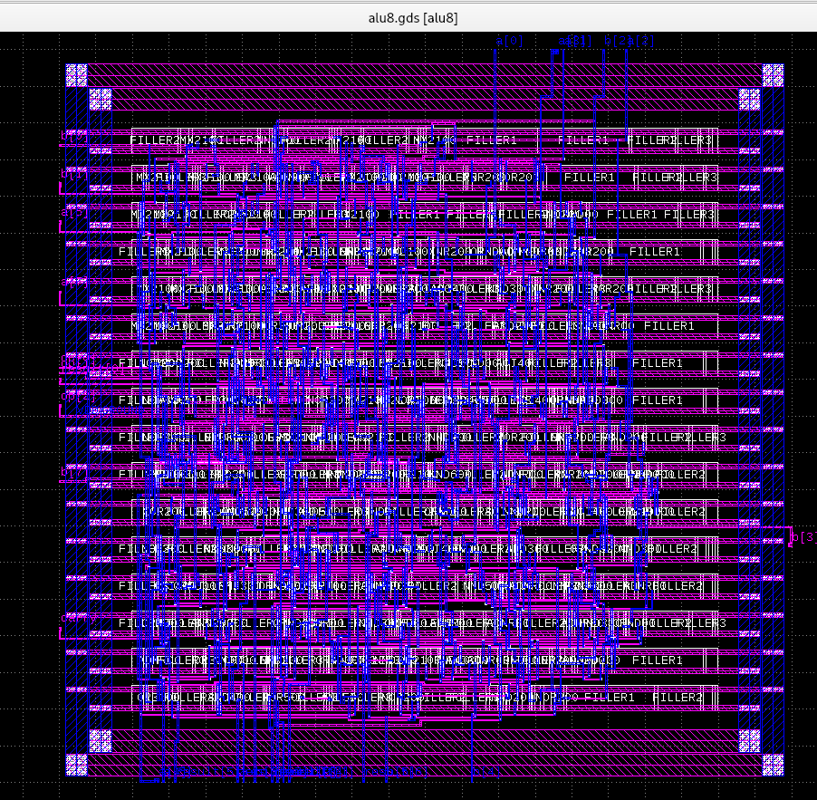

# openlane-alu8

An **8-bit ALU** taken from SystemVerilog RTL through the open-source **OpenLane**
flow on **SCL's 0.8 µm CP8D** open PDK — synthesis → floorplan → PDN → placement →
filler insertion → routing → parasitic extraction → static timing analysis →
KLayout DRC/LVS signoff.

**LVS clean. Router DRC clean. Critical path 11.61 ns ⇒ ≈86 MHz (cell delay only — see the caveat).**

> ⚠️ **Status: routed, LVS signed off, DRC not yet clean.**
> **LVS passes with 0 errors.** Signoff DRC reports **3 boron-width violations**, all on
> the same cell type — see [docs/signoff.md](docs/signoff.md). Gate-level simulation of
> the routed netlist has **not** been run. See [Open items](#open-items).
> Nothing here is a tapeout claim.

> ✅ **The flow is scripted and deterministic.** One `source flow/run_all.tcl` runs it
> end to end. A full re-run reproduced every artefact **byte-identically**, and
> re-running DRC against the regenerated GDS returned the **same 3 violations at the
> same coordinates** — so determinism holds through signoff, not just to STA.
> Both completed run trees are in `runs/`, so the claim is auditable:
> `diff -rq runs/RUN/results runs/RUN_COMPLETE_20261021/results`.
> See [docs/determinism.md](docs/determinism.md).

> 📐 **Chip-level inputs exist but have not been run.** `tapeout/` holds the 4 mm
> pad-framed configuration, the measured frame geometry and an honest gap register:
> [tapeout/TAPEOUT-PLAN.md](tapeout/TAPEOUT-PLAN.md). See [Tapeout](#tapeout).

Companion project: [`openlane-8bit-counter`](https://github.com/sudo-apt-uninstall/openlane-8bit-counter)
— the 8-bit counter that proved this flow end to end (0 DRC, LVS matched, ≈120 MHz).

---

## The design

Purely combinational, no clock, no flip-flops. **29 I/O.**

```
in : a[7:0] + b[7:0] + op[2:0]        = 19
out: result[7:0] + zero + carry       = 10
                                        -- 29
```

| `op` | operation | notes |
|---|---|---|
| `000` | ADD | `temp = {1'b0,a} + {1'b0,b}`, `carry = temp[8]` |
| `001` | SUB | `carry` means **no borrow**: `carry = (a >= b)` |
| `010` | AND | |
| `011` | OR | |
| `100` | XOR | |
| `101` | `a << b[2:0]` | bits above 7 are dropped; `carry` unaffected |
| `110` | `a >> b[2:0]` | bits below 0 are dropped; `carry` unaffected |
| `111` | — | `default`: `result = 0`, `carry = 0` |

`zero` is computed from `result` *after* the `case`, so it is correct for every opcode
including `default`.

Two deliberate RTL choices worth noting, because reviewers often try to "fix" them:

- **Defaults are assigned at the top of `always_comb` before the `case`**, so no latches
  are inferred. This is the single most common ALU bug and it is avoided here.
- **`temp` is 9 bits** and ADD zero-extends both operands, so carry-out is captured
  rather than lost to 8-bit truncation.

---

## Results

| stage | result |
|---|---|
| synthesis (Yosys) | **210 CP8D standard cells** |
| floorplan | 1000 × 1000 µm die, 800 × 800 µm core, **16 rows**, 50.7 µm pitch, ~33 % occupancy |
| PDN | metal1 followpins, 7 µm per row, metal1/metal2 ring |
| placement | `detailed_placement` + `check_placement` clean |
| filler insertion | **566 components = 210 logic + 356 FILLER** |
| routing | **`drc.rpt` 0 bytes — router DRC clean on 2 metal layers** |
| RC extraction | SPEF written, **but capacitance is all zero — PDK limitation, see below** |
| STA — setup | **11.61 ns ⇒ ≈86.1 MHz**, critical path `a[1]` → `zero`, 10 logic levels, **+88.39 MET** |
| STA — hold | **+0.78 MET** — no min-delay problem |
| **signoff LVS** | ✅ **0 errors — layout matches schematic** |
| **signoff DRC** | ⚠️ **3 violations** — minimum boron width, all on `INVR00`, out of 74 rule categories checked |

### The routed layout



210 logic cells and 356 fillers across 16 rows at ~33 % occupancy, routed on the two
metal layers CP8D provides. The sparse look is deliberate: the die was fixed at
1000 × 1000 µm for pad-ring headroom, not shrunk to the logic.

### Cell histogram

```
28 NND200   28 MX2100   23 ORND00   21 NOR200   20 INVR00   18 NND300
15 ADNR00    8 OR2100    8 AOI400    8 AND200    6 NOR300    5 XNR200
 4 XOR200    3 OAI400    3 AND500    3 AND300    2 OR3100    2 NND500
 2 AND400    1 NOR500    1 NND600    1 NND400
```

- **28 × `MX2100`** — the 2:1 mux tree implementing `case (op)`. Expected.
- **No flip-flops**, correctly — the design is combinational.
- **No `ADR100`** (the library's full-adder). Yosys built the carry chain from ordinary
  gates. Reason: ABC is invoked with no delay target and no SDC, so it maps for **area**,
  and the larger full-adder cell loses. Not a library defect.
- **20 × `INVR00`** — three of these are the sites of the signoff DRC violations.

### 🔴 Mandatory caveat on the 86 MHz number

> **Cell delay only — interconnect parasitics are not modelled by the SCL PDK.**

The SPEF was generated and read, but the OpenRCX rule deck for this process produces
**zero capacitance on every net**. The figure is also **typical corner only** (5 V,
25 °C); CP8D ships no worst-case library. Real post-layout timing will be slower.
This must never be presented as signoff timing.

For scale on how slow this process is: `NND600` alone costs **2.50 ns**.

---

## Running it

The whole flow runs from a single driver, [`flow/run_all.tcl`](flow/run_all.tcl):

```bash
./flow.tcl -design project_scl_cp8d/alu8 -tag RUN -interactive -overwrite
% source $::env(DESIGN_DIR)/run_all.tcl
```

It executes synthesis → floorplan → PDN → placement → fill → routing → RCX → STA and
asserts after each stage that a non-empty artefact was produced. `run_openroad_script`
takes a **path** argument and prints nothing on success, so checking **file sizes** —
not just existence — is the only way to know a stage worked.

⚠️ **`-overwrite` deletes the entire `runs/RUN` directory**, including anything you
parked inside it. Copy results, `cmds.log` and the signoff tree elsewhere first.

🔴 **Never run `cts_cp8d.tcl`** — it calls `[get_ports clk]` and this design has no clock
port. `fill_cp8d.tcl` replaces it; see [docs/flow-notes.md](docs/flow-notes.md).

### Signoff

`signoff/cdl_gds_script.source` builds the CDL and GDS and then opens the KLayout GUI,
where DRC and LVS were run **by hand** — which is why the first signoff left no command
trail. [`signoff/signoff.sh`](signoff/signoff.sh) is the headless replacement: the same
two generation steps, then DRC and LVS in batch, then a verdict on stdout.

⚠️ **`signoff.sh` has not been executed yet.** The KLayout decks are PDK files and are
not in this repository, so the `-rd` variable names they expect could not be confirmed
from here. Rather than guess, the script inspects both decks and prints the variables
they actually reference; override with `DRC_IN` / `DRC_OUT` / `LVS_IN` /
`LVS_SCHEMATIC` / `LVS_OUT` once, and signoff is reproducible from then on.

The flow itself still has **no GDS streamout stage**, so signoff artefacts must be
regenerated after any re-run before they describe the current layout. Details in
[docs/signoff.md](docs/signoff.md).

---

## What had to change to run a combinational design

The SCL reference flow was built around a **clocked** counter. Seven input-side changes
were needed. Full detail in [docs/flow-notes.md](docs/flow-notes.md).

1. `alu8.sv` copied to `1_RTL/alu8.v` — the Yosys script hardcodes `DESIGN_NAME.v`.
   **The content is still SystemVerilog; only the extension changed.**
2. `-sv` added to `read_verilog` in `yosys_script.tcl`.
3. `config.json` — `CLOCK_PORT ""`, `CLOCK_NET ""`, `RUN_CTS false`, 1000 µm die.
4. `pin_order.cfg` — 29 pins across the four edges.
5. `run_sta.tcl` — a **virtual clock** replacing `create_clock ... [get_ports clk]`.
6. **`fill_cp8d.tcl`** — a new, hand-written CTS substitute that preserves filler
   insertion. The reference flow only inserts fillers *inside* CTS, so skipping CTS
   silently loses them.
7. `signoff/cdl_gds_script.source` — the signoff driver, retargeted from the counter
   smoke test to `alu8`. Three lines — `smoke` / `cnt8` / `cnt8_top` → `alu8` / `alu8` /
   `alu8` — but it is an **input**: a clean checkout will not have it.
   ⚠️ The unmodified SCL template is **not** in this repository; it exists only on the
   machine the flow was run on, so the diff cannot be reproduced from here.

**Provenance:** of the 10 reference Tcl scripts, **8 are byte-identical to SCL's
upstream** and only `run_sta.tcl` and `yosys_script.tcl` differ — exactly the two edits
above. Every result here is stock-script output.

---

## Tapeout

[`tapeout/`](tapeout/) holds the chip-level inputs for a **4 mm × 4 mm** pad-framed
version. **None of it has been run.** The full plan, with the arithmetic behind every
number, is in [tapeout/TAPEOUT-PLAN.md](tapeout/TAPEOUT-PLAN.md).

| | value |
|---|---|
| die | 4 mm × 4 mm — 40 pads = 32 usable I/O + 8 power |
| design I/O | **29** of 32, so pin count fixes the die, not area |
| core opening | **`304.90 304.90 3695.10 3695.10`** — **measured** from `frame4mmx4mm.gds`, not derived |
| pin split | **8 / 8 / 8 / 5**. Every edge has exactly 8 signal positions; the other two are power |

Three things stand between this and a submittable GDS, and only the first is ours:

1. **3 unwaivable DRC violations.** The `999:0` waiver layer is hard-capped at **2
   polygons** and there are **3** items, so at least one must be genuinely fixed.
   A plain re-run cannot help — the flow is byte-identically deterministic through
   signoff. Two experiments decide it: a standalone `INVR00` DRC run (library defect?)
   and the chip run itself, which drops occupancy from ~33 % to ~0.4 % and so tests the
   `NND200`→`INVR00` abutment hypothesis for free.
2. **Pad conversion.** The frame ships **16 input pads, 16 dead pads and zero outputs** —
   `ASPAD00` has only three terminals (bond pad + 322 Ω nwell resistor + ESD diodes) and
   **no path to the core at all**. Converting costs **13 swaps minimum**, or **18** for a
   bus-aligned floorplan that keeps `result[7:0]` on one edge. Every swap also requires
   editing `frame4mmx4mm.cdl`, or chip-level LVS fails.
3. **Blocked on SCL.** No **antenna rule deck** exists anywhere in the PDK or its five
   documents, yet submission requires an antenna-clean GDSII. The **Tapeout Submission
   Form** and the **seal ring** are likewise named but never supplied. No amount of
   core-side work removes these.

---

## Open items

1. **Signoff DRC — 3 boron-width violations.** All on `INVR00`, each 50 nm short of the
   3.4 µm minimum, and reproducible run to run. They are **one defect at three sites**:
   relative to each instance origin the violation sits at Δx = 0.00, Δy = +17.35/+20.70
   in all three. Working hypothesis is the `NND200 → INVR00` hard-abutment seam; the
   deciding experiment is a standalone DRC run on the cell alone. Full analysis,
   including a corroborating `DRC_EXCLUDE_CELL_LIST_OPT = "INVR01"` found in SCL's own
   config, in [docs/signoff.md](docs/signoff.md).
2. **Gate-level simulation of the routed netlist — not run.** The inputs exist
   (`alu8_rt_sim.v`, which carries no supply pins and so drops straight into the
   existing testbench, plus `alu8_rt.sdf`). This is the only step that verifies the
   routed netlist actually *computes correctly*.
3. **Signoff scripted but unverified.** [`signoff/signoff.sh`](signoff/signoff.sh)
   replaces the manual GUI run, but has not been executed: the deck `-rd` variable names
   need one confirmation on the machine that has the PDK. Until then, DRC and LVS remain
   reproducible only by hand.
4. **Wire-load RC experiment — inconclusive, and the script is gone.** `cmds.log` shows
   `run_sta_wirerc.tcl` *was* executed twice (21 Oct, 22:55:41 and 23:26:33), so the
   earlier claim that it "never reached disk" is **withdrawn**. The file was deleted
   afterwards and is absent from `flow/3_src/`. It must be rewritten from scratch; both
   runs produced byte-identical output despite a 187× intended capacitance change, and
   why remains unexplained.
5. **No GDS streamout in the flow.** `run_all.tcl` ends at STA, so every re-run leaves
   the signoff artefacts describing the previous layout until they are regenerated by
   hand. Folding steps 1–2 of `signoff.sh` into the driver would close this.

### Known RTL gaps

- No signed **overflow** flag (`carry` is the unsigned indicator only).
- Shifts drop ejected bits and never set `carry`; the convention is undecided.
- `op = 3'b111` is never exercised by the testbench, so the `default` branch is dead in
  simulation.
- The testbench is **9 directed vectors**. A full `a × b × op` sweep is only
  8 × 256 × 256 = 524,288 evaluations — trivially runnable, and it would *prove* the
  design rather than sample it.

---

## A note on tap cells

A reasonable instinct on a CMOS flow is "insert tap cells to guarantee well/substrate
contact and prevent latch-up." **On CP8D that does not apply:** the library ships
**no tap/welltap/subtap macro at all** — 65 LEF macros against 59 Liberty cells, and
the six LEF-only ones are exactly `FILLER1`…`FILLER6`. The only other physical-only
cells are `VDDCON` (`TIEHI`) and `VSSCON` (`TIELO`), which are tie cells.

At 0.8 µm the well and substrate contacts are drawn **inside each standard cell and
inside the fillers**; the separate-tap-cell-on-a-pitch scheme is a deep-submicron
convention. **On this process, filler insertion *is* the tap strategy** — which is
precisely why the `fill_cp8d.tcl` rescue above matters, and why the re-run verifies the
filler count (356) explicitly.

Note that tap cells are therefore **not** the fix for the boron violations in
[docs/signoff.md](docs/signoff.md) — there is nothing to insert, and the fillers that
provide continuity are all present.

---

## Repository layout

```
rtl/        alu8.sv, tb_alu8.sv
flow/       run_all.tcl  — single-command driver for the whole flow
            config.json, pin_order.cfg, 3_src/*.tcl as actually executed
results/    flattened artefacts: synthesis netlist, floorplan/placement/cts/
            routing DEFs, routed netlists (_pwr/_sim), SPEF, SDF, STA reports
signoff/    cdl_gds_script.source + script/ (DEF→GDS, Verilog→CDL), signoff.sh
            (headless DRC/LVS, not yet executed), and lvs_drc/ holding the GDS,
            CDL, extracted netlist, LVS database and the KLayout DRC report
tapeout/    chip-level inputs for the 4 mm pad frame — config_chip.json,
            pin_order_chip.cfg, run_chip.tcl, TAPEOUT-PLAN.md. NOT executed
runs/       the three raw run trees — see docs/failed-runs.md
netlist/    alu8_netlist.v — generic Yosys output, NOT technology-mapped
docs/       flow-notes.md, signoff.md, determinism.md, failed-runs.md, images/
MANIFEST.md byte sizes of every tracked artefact, and what was excluded
```

Three run directories are preserved under `runs/`: `RUN` (the 2026-10-22 scripted
re-run), `RUN_COMPLETE_20261021` (the original run, executed by hand) and `RUN.bak`
(an aborted attempt, kept as failure evidence). The two completed trees are separate
executions whose `results/` are byte-identical — that is the determinism claim in a
form anyone can check. Each tree's `tmp/` is excluded: it holds merged LEF and Liberty
files copied out of the PDK, roughly 14.5 MB per tree.

⚠️ `netlist/alu8_netlist.v` is Yosys **generic** output: 322 `assign` statements, 318
wires, **zero cell instances**. It is kept for provenance only. **No area, cell-count or
timing number may be quoted from it** — OpenLane re-synthesises from `1_RTL/` anyway.

---

## Credits and licensing

PDK: **SCL Mohali** 0.8 µm CP8D open PDK, distributed via echiphub.in / NIELIT.
**The PDK itself is not redistributed in this repository.**

Tooling: OpenLane v1.0.2 (`ff5509f6`), Yosys, OpenROAD, OpenSTA, KLayout.

Design work: Deepesh J and Sai Darshan. Individual learning project for OpenLane flow
exposure — **not** a commercial or employer deliverable.
